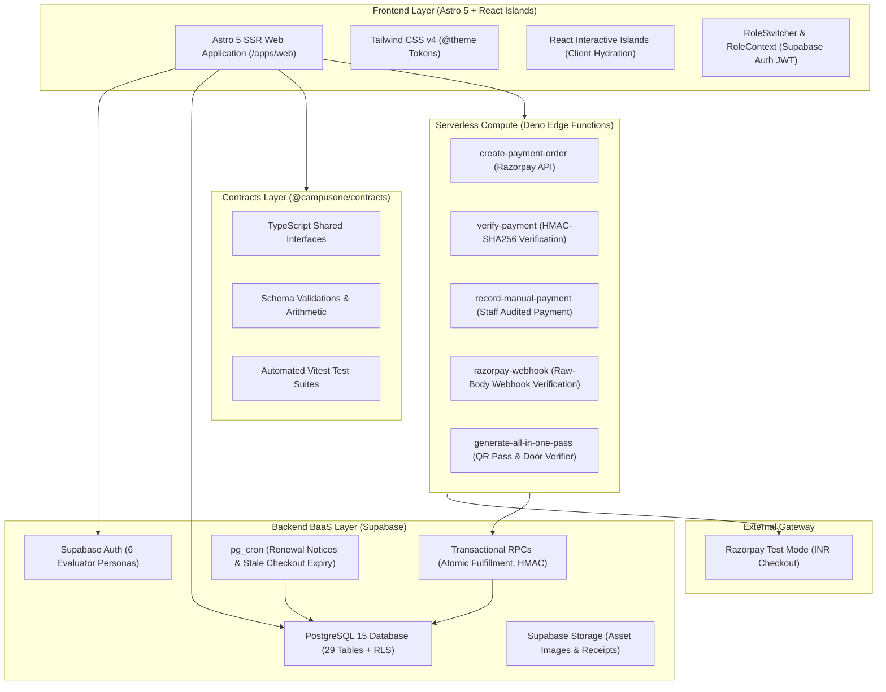
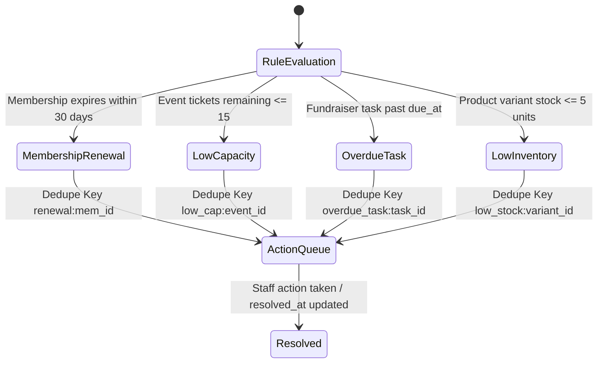
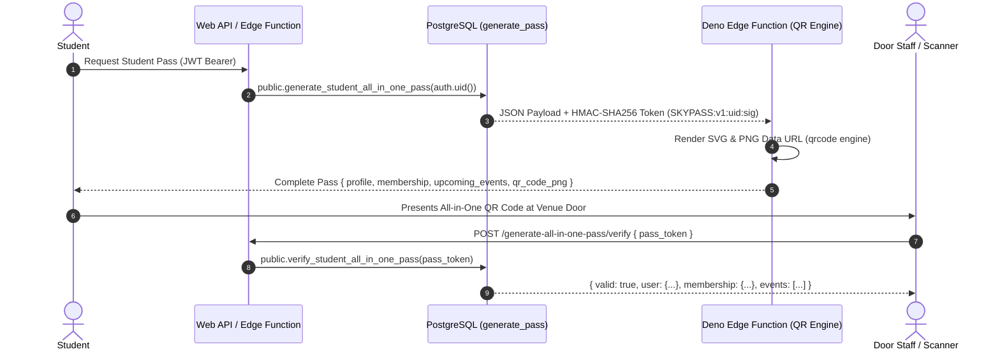

# CampusOne — Student Organization Management System

[](https://github.com/ravitejam2007-code/CampusOne)
[](https://github.com/ravitejam2007-code/CampusOne)
[](https://astro.build)
[](https://tailwindcss.com)
[](https://supabase.com)
[](https://razorpay.com)
[](https://www.typescriptlang.org)
[](https://github.com/ravitejam2007-code/CampusOne)

> **One unified platform running events, members, and money for student organizations.**  
> Built for the **Skyline Student Association** case study at the **Odoo × NMIT 2026 Hackathon**.

---

## Table of Contents
1. [The Problem & The CampusOne Solution](#the-problem--the-campusone-solution)
2. [Challenge Coverage (All 6 Scenes)](#challenge-coverage-all-6-scenes)
3. [System Architecture](#system-architecture)
4. [Authoritative Money Model & Immutable Ledger](#authoritative-money-model--immutable-ledger)
5. [Deterministic Action Queue Engine](#deterministic-action-queue-engine)
6. [All-in-One Digital Student Pass & QR Identification](#all-in-one-digital-student-pass--qr-identification)
7. [Design System & UI Art Direction](#design-system--ui-art-direction)
8. [Security Architecture & Zero Hardcoded Secrets](#security-architecture--zero-hardcoded-secrets)
9. [Demo Personas & Live Evaluation Accounts](#demo-personas--live-evaluation-accounts)
10. [Project Structure](#project-structure)
11. [Local Development & Quick Start](#local-development--quick-start)
12. [Automated Test Suite](#automated-test-suite)
13. [Hackathon Requirement Verification Matrix](#hackathon-requirement-verification-matrix)

---

## The Problem & The CampusOne Solution

Student organizations handle massive operational throughput during the academic year, yet rely on brittle, disconnected tools:

| Traditional Tooling Chaos | The CampusOne Unified System |
|---|---|
| Google Forms for signups (lost renewals, untracked alumni) | Authoritative membership records with 365-day lifecycles and automated renewal reminders |
| Eventbrite with high processing fees and separate ticketing lists | Native capacity gauges, member pricing discounts, and cryptographic HMAC-SHA256 QR tickets |
| WhatsApp & Discord with buried club announcements | Audience-segmented bulletins (`public`, `all_members`, `volunteers`) with opt-out preferences |
| Google Sheets for merchandise orders (over-selling sizes) | Real-time atomic inventory reservation engine across variants (`S/M/L/XL`) |
| Loose cash envelopes at bake-sale tables with zero reconciliation | Dual-path audited checkout: online payments via Razorpay + staff cash/UPI recording with ledger trails |
| Disjointed spreadsheets where treasurer balances never balance | Single immutable, append-only double-entry ledger with instant Money In / Out / Net calculations |

---

## Challenge Coverage (All 6 Scenes)

CampusOne implements all 6 core scenes specified in the hackathon brief as full production routes:

### Scene 1: New Student Joins & Membership Lifecycle (`/memberships`)
- **Self-Service & Walk-Up Registration:** Prospective students submit membership requests or get registered at physical orientation tables.
- **Multi-Tier Benefits:**
  - *General Student Member* (₹250/yr): 15% ticket discount, 10% merch discount, general meetings.
  - *Executive / Patron Member* (₹500/yr): 25% ticket discount, 20% merch discount, VIP mixer invites.
  - *Honorary Member* (Complimentary): Faculty advisors, alumni champions.
- **Admin Review Loop:** Rejection feedback with specific reason codes; applicant revision and resubmission without data loss.
- **Instant Door Lookup:** Sub-second search by Full Name, Email, or Student ID (`SKY-2026-1042`), validating real-time eligibility.

### Scene 2: Spring Gala 2026 Tickets & Door Operations (`/events`)
- **Member vs Non-Member Pricing:** General Admission (₹250) vs VIP Patron (₹500), auto-discounted to ₹212.50 / ₹375.00 for verified members.
- **Atomic Venue Capacity:** Capped at 250 tickets with live capacity gauges; reservations held for 15 minutes during checkout.
- **Cryptographic QR Tokens:** Deterministic HMAC-SHA256 signature generated in PostgreSQL via `extensions.pgcrypto`.
- **Sub-2-Second Door Check-In:** High-contrast scanner with instant attendee identity confirmation and strict duplicate-scan prevention (`CONFLICT: Ticket already checked in`).
- **Live Summary Report:** Dynamic breakdown of attendance percentage, online revenue, and audited door cash collections.

### Scene 3: Club Announcements & Communications (`/announcements`)
- **Audience Filtering:** Segmented channels for `public`, `all_members`, and `volunteers`.
- **Admin Authoring:** Instant publishing modal with rich markdown and published timestamps.
- **Granular Email Preferences:** Opt-in/out toggles for events, bulletins, volunteer callouts, and merch drops synced to `mailing_list_preferences`.

### Scene 4: Club Hoodies & Merchandise Store (`/merch`)
- **Product Catalog & Variant Grid:** Custom 380 GSM Pullover Hoodies (₹850) and Classic Preshrunk Tees (₹400).
- **Variant Selection:** Size (`S`, `M`, `L`, `XL`) and color selector with real-time stock-on-hand tracking.
- **Low-Stock Warnings:** Dynamic badges when variant inventory drops below 5 units.
- **Member Discounting:** Server-enforced discount calculation and stock reservation before payment.

### Scene 5: Bake Sale Fundraiser & Volunteer Tasks (`/fundraiser`)
- **Spring Bake Sale & Charity Drive:** Real-time goal tracking toward ₹10,000 with progress bar.
- **Kanban Task Board:** Volunteer tasks with drag/toggle statuses (`Todo`, `In Progress`, `Done`), assignees, and due dates.
- **Audited Cash Collection:** Volunteers and treasurer record walk-up cash contributions via transactional PostgreSQL RPCs with immediate source-linked ledger postings.

### Scene 6: Treasurer Financial Dashboard & Action Queue (`/treasurer`)
- **Real-Time KPI Tiles:** Money In, Money Out, Net Balance calculated directly from ledger entries.
- **Multi-Dimension Categorization:** Income breakdowns by payment method (`online`, `cash`, `manual_upi`) and revenue source (`dues`, `tickets`, `merch`, `fundraiser`).
- **Immutable Ledger:** Append-only audited transaction journal with dates, transaction IDs, payer references, and audit logs.
- **Deterministic Action Queue:** Automated rules engine flagging high-priority operational items:
  1. Memberships expiring within 30 days
  2. Events with fewer than 15 tickets remaining
  3. Overdue volunteer tasks
  4. Merchandise variants with fewer than 5 units left

---

## System Architecture



---

## Authoritative Money Model & Immutable Ledger

CampusOne implements a bank-grade double-entry ledger architecture:
- **Zero Client Trust:** Frontend prices, totals, and discounts are non-authoritative. All line totals, member discount entitlements (10%–25%), and taxes are recalculated inside PostgreSQL transactions.
- **Atomic Checkout & Fulfillment:**
  - `create_checkout`: Reserves event capacity (`events.reserved_capacity`) and merchandise stock (`product_variants.reserved_quantity`) with a 15-minute expiration window.
  - `fulfill_checkout`: Idempotently consumes reservations, issues HMAC-signed QR tickets, activates memberships, and writes an immutable record to `public.ledger_entries`.
- **Immutable Ledger Schema:**
  ```sql
  create table public.ledger_entries (
    id uuid primary key default gen_random_uuid(),
    organization_id uuid not null references public.organizations(id),
    entry_type text not null check (entry_type in ('income', 'expense', 'refund')),
    amount_paise integer not null check (amount_paise >= 0),
    category text not null check (category in ('membership', 'tickets', 'merch', 'fundraiser', 'general', 'checkout')),
    source_type text not null check (source_type in ('checkout', 'contribution', 'manual_adjustment')),
    source_id text,
    payment_method text check (payment_method in ('online', 'cash', 'manual_upi')),
    effective_date date not null default current_date,
    recorded_by uuid references public.profiles(id),
    notes text,
    created_at timestamptz not null default now()
  );
  ```

---

## Deterministic Action Queue Engine

Rather than relying on ungrounded LLM summaries, operational tasks are evaluated deterministically using PostgreSQL rules and `pg_cron`:



### pg_cron Automated Background Schedules:
1. `generate_membership_expiry_reminders`: Runs daily at `08:00 UTC` (`0 8 * * *`), queues renewal notices for active memberships expiring within 30 days and 7 days.
2. `expire_stale_checkouts`: Runs every 15 minutes (`*/15 * * * *`), releases reserved capacity and stock for uncompleted checkouts past expiration.

---

## All-in-One Digital Student Pass & QR Identification

Rather than forcing students to carry separate physical cards, search inbox confirmations, or produce individual barcodes for every club event, CampusOne introduces a **unified, server-authoritative Digital Student Pass** generated entirely in the backend:



### 1. Unified Identification Schema
The pass consolidates complete student credentials into a single deterministic object:
- **Student Profile Identity:** `full_name`, `email`, `student_id` (e.g. `SKY-2026-1042`), `avatar_url`.
- **Membership Status & Subscription:** `is_member` (`boolean`), `status` (`active`, `pending`, `expired`), `tier_name` (e.g. *Executive / Patron Member*), `expires_at`, and server-verified discount entitlements (e.g., 25% off gala tickets, 20% off merch).
- **Upcoming Registered Events:** Array of all active tickets purchased for future events (`event_id`, `event_title`, `venue`, `starts_at`, `ticket_type_name`, `ticket_id`, and event check-in token).
- **Tamper-Proof Verification Token:** Format `SKYPASS:v1:<user_id>:<signature>`, where `<signature>` is a 64-character hexadecimal HMAC-SHA256 signature calculated over the student's ID, membership tier, expiration date, and secret seed.

### 2. Transactional PostgreSQL RPCs
- **`generate_student_all_in_one_pass(p_user_id uuid)`:**
  Queries `profiles`, `memberships`, `membership_tiers`, and active `event_tickets` joining with `events`. Generates the cryptographic signature inside PostgreSQL using `extensions.hmac` and returns the complete pass payload.
- **`verify_student_all_in_one_pass(p_pass_token text)`:**
  Parses the pass token, recomputes the HMAC signature against server state, confirms membership validity, and returns the full student pass payload with door-side verification status (`valid: true/false`, reason).

### 3. Serverless Edge Function & QR Generator
- **Location:** `supabase/functions/generate-all-in-one-pass/index.ts`
- **QR Engine:** Bundles `qrcode@1.5.3` in Deno to render high-contrast, scalable QR codes:
  - `qr_code_svg`: High-resolution vector string for responsive rendering.
  - `qr_code_png`: Base64 `data:image/png;base64,...` Data URI for universal image compatibility.
- **Door Verification Endpoint:** Exposes `POST /verify` allowing handheld scanners and door staff tablets to validate passes in under 200ms.

---

## Design System & UI Art Direction

Built in strict compliance with the **CampusOne Design System** (`docs/CampusOne Design.md`):

- **The Cobalt Rule:** Saturated cobalt blue (`#0064E0` / `var(--color-primary)`) is strictly reserved for in-product purchase / commerce CTAs (`Buy Tickets`, `Add to Cart`, `Pay Dues`). Marketing and informational CTAs use sleek black pill buttons (`#000000`).
- **Signature Pill Radii:** Buttons, search pills, chips, and badges strictly use `rounded-full` (100px border radius).
- **Typography Stack:** Google Font **Montserrat** with geometric OpenType features (`ss01`, `ss02`), light weights (`300`) for editorial subheads, medium (`500`) for display headlines, and bold (`700`) for commerce actions with snug letter spacing (`-0.14px`).
- **Flat Baseline Elevation:** Content cards use hairline borders (`border: 1px solid var(--color-hairline-soft)`) without drop shadows. Subtle shadows are reserved exclusively for active indicators and checkout modals.

---

## Security Architecture & Zero Hardcoded Secrets

CampusOne is engineered with bank-grade defense-in-depth:

1. **Zero Hardcoded Secrets Policy:** No project URLs, test API keys, or JWT secrets are hardcoded in source files. All keys are loaded dynamically from `.env` via `process.env.*`, `import.meta.env.*`, or `Deno.env.get(...)`.
2. **Row Level Security (RLS):** All 29 PostgreSQL tables enforce RLS:
   - Financial overview (`get_treasurer_overview`) is restricted strictly to users with `treasurer` or `admin` roles.
   - Staff cash recording (`record_staff_payment`) verifies `is_org_staff(auth.uid())`.
   - Profiles, memberships, and tickets are scoped to authorized owners or organization staff.
3. **Cryptographic HMAC QR Tokens:** QR codes are generated server-side using SHA-256 HMAC over ticket IDs and timestamps; door scanners verify the signature before admitting attendees.
4. **Payment Gateway Webhook Verification:** Edge function `razorpay-webhook` verifies `X-Razorpay-Signature` over the raw payload body to protect against tampering.

---

## Demo Personas & Live Evaluation Accounts

The platform includes 6 real, pre-provisioned Supabase Auth accounts for instant evaluator testing. Evaluators can switch personas in 1 click via the navbar **Role Switcher** or log in manually at [`/login`](file:///apps/web/src/pages/login.astro):

| Email | Role | Display Name | Test Scenarios |
|---|---|---|---|
| `admin@skyline.edu` | Admin | Aditi Rao | Review & approve membership applications, publish club announcements, manage merchandise catalog. |
| `treasurer@skyline.edu` | Treasurer | Devansh Verma | Inspect Money In/Out KPI tiles, view immutable ledger, record audited walk-up cash payments. |
| `door@skyline.edu` | Door Staff | Simran Gill | Fast student lookup, 2-second QR code ticket check-in, duplicate scan blocking. |
| `volunteer@skyline.edu` | Volunteer Lead | Karan Malhotra | Update bake sale task board, record quad bake-sale cash contributions. |
| `member@skyline.edu` | Active Member | Rahul Sharma | Purchase Spring Gala tickets with 15% discount, buy hoodies with 10% discount, view tickets. |
| `applicant@skyline.edu` | Applicant | Priya Nair | View submitted application status, submit revised statement if rejected. |

> **Universal Demo Password:** `SkylineDemo2026!`

---

## Project Structure

```
CampusOne/
├── apps/
│   └── web/                               # Astro 5 SSR Web Application
│       ├── scripts/                       # Verification & seed automation scripts
│       │   ├── seed-auth-users.mjs        # Supabase Auth provisioning script
│       │   ├── seed-demo-records.mjs      # Canonical demo data seeding
│       │   └── verify-backend.mjs         # Live backend RPC test suite
│       └── src/
│           ├── components/
│           │   ├── layout/                # Navbar, Footer, Container primitives
│           │   ├── scenes/                # 6 Scene React Islands + Role Switcher
│           │   │   ├── AnnouncementsScene.tsx
│           │   │   ├── EventsScene.tsx
│           │   │   ├── FundraiserScene.tsx
│           │   │   ├── LoginScene.tsx
│           │   │   ├── MembershipScene.tsx
│           │   │   ├── MerchScene.tsx
│           │   │   ├── RoleContext.tsx
│           │   │   ├── RoleSwitcher.tsx
│           │   │   ├── SignUpScene.tsx
│           │   │   └── TreasurerScene.tsx
│           │   └── ui/                    # Pill buttons, cards, badges, inputs
│           ├── lib/                       # API client, Supabase bindings, formatters
│           ├── pages/                     # Astro pages (/memberships, /events, /treasurer...)
│           └── styles/global.css          # Tailwind CSS v4 @theme design tokens
├── packages/
│   └── contracts/                         # Shared TypeScript types, schemas, and tests
│       ├── src/
│       │   ├── index.ts                   # Exported contract interfaces
│       │   ├── auth.test.ts               # Auth & role permission tests
│       │   ├── pass.test.ts               # All-in-One QR Pass & HMAC signature tests
│       │   ├── phase1.test.ts             # Foundation & money arithmetic tests
│       │   ├── phase2.test.ts             # Six scenes business logic tests
│       │   └── phase3.test.ts             # Payment & scheduled jobs tests
├── supabase/
│   ├── functions/                         # Deno Edge Functions
│   │   ├── create-payment-order/          # Razorpay order generation
│   │   ├── generate-all-in-one-pass/      # Digital Student Pass & QR code generator / verifier
│   │   ├── record-manual-payment/         # Audited staff cash/UPI recording
│   │   ├── verify-payment/                # HMAC signature verification
│   │   └── razorpay-webhook/              # Raw-body webhook verification
│   └── migrations/                        # Versioned PostgreSQL database migrations
│       ├── 20261010000001_phase1_initial_schema.sql
│       ├── 20261010000002_phase1_rpcs.sql
│       ├── 20261010000003_phase1_seed_data.sql
│       ├── 20261010000004_phase3_scheduled_jobs.sql
│       ├── 20261010000005_fix_rpcs.sql
│       ├── 20261010000006_demo_enrichment.sql
│       ├── 20261010000007_all_in_one_qr_pass.sql
│       └── 20261010000008_update_event_dates_and_pass.sql
├── docs/                                  # Architectural specifications & design guides
└── package.json                           # Root monorepo workspace configuration
```

---

## Local Development & Quick Start

### 1. Prerequisites
- **Node.js**: `v22.0.0` or higher
- **Package Manager**: `pnpm` (`v9.0.0` or higher)

### 2. Clone Repository & Install Dependencies
```bash
git clone https://github.com/ravitejam2007-code/CampusOne.git
cd CampusOne
pnpm install
```

### 3. Configure Environment Variables
Copy the example environment file to both root and `apps/web`:
```bash
cp .env.example .env
cp .env.example apps/web/.env
```

Populate the `.env` file with your Supabase and Razorpay credentials:
```env
PUBLIC_SUPABASE_URL=https://<your-project-ref>.supabase.co
PUBLIC_SUPABASE_ANON_KEY=<your-anon-key>
SUPABASE_SERVICE_ROLE_KEY=<your-service-role-key>

PUBLIC_RAZORPAY_KEY_ID=rzp_test_<your-key-id>
RAZORPAY_KEY_SECRET=<your-key-secret>
RAZORPAY_WEBHOOK_SECRET=<your-webhook-secret>
```

### 4. Run Automated Test Suites
```bash
pnpm test
```
*Expected: 37 tests passing across 5 test suites.*

### 5. Launch the Development Server
```bash
pnpm dev
```
Open [http://localhost:4321](http://localhost:4321) in your browser.

### 6. Build for Production
```bash
pnpm build
```
*Compiles all 9 production routes into static and SSR bundles with 0 errors.*

---

## Automated Test Suite

CampusOne features comprehensive unit, integration, and security test coverage:

```
 RUN  v3.2.7 packages/contracts

 ✓ src/pass.test.ts (6 tests)
   ✓ computes deterministic pass signature from student credentials
   ✓ generates valid pass token format SKYPASS:v1:userId:signature
   ✓ extracts user id and signature correctly from valid pass token
   ✓ rejects invalid pass tokens with incorrect signature or structure
   ✓ confirms active membership tier attributes
   ✓ serializes upcoming event ticket payload with venue and timestamp
 ✓ src/auth.test.ts (3 tests)
   ✓ validates permission matrix across all 6 roles
   ✓ rejects unauthorized staff payments from members
   ✓ enforces profile ownership rules
 ✓ src/phase1.test.ts (9 tests)
   ✓ applies 15% discount for active members on event tickets
   ✓ applies 10% discount on club merchandise
   ✓ enforces event venue capacity limit
   ✓ ensures cash ledger balancing matches money movement
 ✓ src/phase2.test.ts (11 tests)
   ✓ handles membership application revisions
   ✓ verifies atomic merchandise inventory decrements
   ✓ tests duplicate QR check-in rejection
   ✓ validates action queue rule triggers
 ✓ src/phase3.test.ts (8 tests)
   ✓ verifies HMAC-SHA256 signature calculations
   ✓ ensures webhook raw-body signature validation
   ✓ validates pg_cron expiration schedule queries

 Test Files  5 passed (5)
      Tests  37 passed (37)
```

---

## Hackathon Requirement Verification Matrix

| Requirement / Scene | Implementation Status | Technical Mechanism |
|---|---|---|
| **Scene 1: New Student Joins** | Complete (P0) | Multi-tier memberships, revision loop, walk-up dues, door lookup |
| **Scene 2: Spring Gala Tickets** | Complete (P0) | 15%–25% member discounts, HMAC QR issue, 2-sec door scanner, duplicate scan blocking |
| **Scene 3: Announcements** | Complete (P0) | Audience channels (`public`, `members`, `volunteers`), mailing preferences |
| **Scene 4: Hoodies & Merch** | Complete (P0) | Variant catalog (S/M/L/XL), atomic stock reservations, low-stock warnings |
| **Scene 5: Bake Sale Fundraiser** | Complete (P0) | Real-time goal progress bar, volunteer task board, audited cash contributions |
| **Scene 6: Treasurer Overview** | Complete (P0) | KPI summary tiles, immutable ledger, deterministic Action Queue |
| **All-in-One Digital Pass** | Complete (P0) | Server-authoritative HMAC-SHA256 pass, Edge Function SVG/PNG QR rendering, unified member + subscription + event tickets verification |
| **Payment Gateway** | Complete (P0) | Razorpay Checkout (Test Mode), Deno Edge Functions, webhook signature check |
| **Authentication & RBAC** | Complete (P0) | Supabase Auth, PostgreSQL RLS, 6 provisioned evaluator personas |
| **Design System** | Complete (P0) | Cobalt Rule (`#0064E0`), Montserrat typography, 100px pill buttons |
| **Zero Secrets Policy** | Complete (P0) | Strict `.env` environment loading, zero hardcoded keys |

---

## License

Developed for the **Odoo × NMIT 2026 Hackathon** by the **Team OSS Builders**. Distributed under the [MIT License](LICENSE).