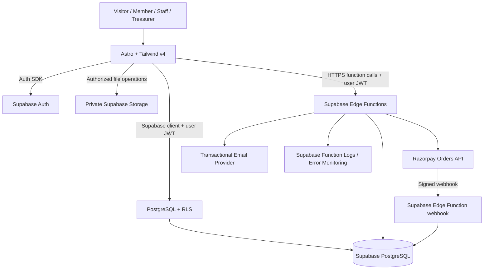

# CampusOne — Hackathon Architecture & Implementation Plan

**Project:** CampusOne — Student Organization Management System  
**Context:** Odoo × NMIT 2026 hackathon  
**Document type:** Engineering implementation plan  
**Status:** Hackathon-scoped implementation plan  
**Version:** 2.0  
**Date:** 10 October 2026

---

## 1. Executive recommendation

Build CampusOne as a **Supabase-first BaaS application**: one Astro frontend, Supabase PostgreSQL, Supabase Auth, Row Level Security (RLS), private Supabase Storage, Supabase Edge Functions for privileged/server-side integrations, and Razorpay Checkout. There is no separately hosted Node.js/Express backend. Keep critical business rules in database constraints, transactions, and narrowly scoped Edge Functions.

### Recommended stack

| Layer | Recommendation | Why |
|---|---|---|
| Web UI | Astro 5+ with TypeScript | Fast server-rendered public pages and a clear component structure |
| Interactive UI | Astro components first; React islands only for complex interactions | Avoid shipping a large client-side app where it is not needed |
| Styling | Tailwind CSS v4 via `@tailwindcss/vite` | Utility styling and shared design tokens |
| Backend platform | Supabase Backend-as-a-Service (BaaS) | Managed database, authentication, storage, row-level security, and serverless functions without hosting an Express server |
| Database | Supabase PostgreSQL | Relational data, constraints, transactions, indexes, and managed operations |
| Identity | Supabase Auth | Password handling, email verification, recovery, and sessions |
| Authorization | PostgreSQL RLS + database constraints + narrowly scoped Supabase Edge Functions | Defence in depth; a hidden button is not a security boundary |
| Browser data access | `@supabase/supabase-js` using the publishable key and the signed-in user's session | Direct access is safe only for tables/functions protected by correctly tested RLS and grants |
| Privileged/server-side logic | Supabase Edge Functions (Deno/TypeScript) | Managed serverless functions for secrets, payments, webhooks, email, and privileged workflows |
| Atomic workflows | PostgreSQL functions/RPC + transactions and constraints | Keep capacity, stock, check-in, and ledger invariants atomic inside the database |
| File storage | Private Supabase Storage buckets | Receipts and restricted documents should not be public |
| Payments | Razorpay Checkout + server-created orders + verified webhooks | Provider-backed payment state, with idempotent fulfilment |
| Email | Resend or another real transactional email provider | Verifiable delivery attempts; provider can be changed later |
| QR | `qrcode` for generation; `html5-qrcode` or a maintained browser scanner for scanning | QR contains an opaque token, not personal information |
| API contracts | Typed Supabase queries/RPC contracts plus documented Edge Function request/response schemas | Clear contract between Astro, PostgreSQL functions, and Edge Functions |
| Tests | Vitest, Deno tests for Edge Functions, Playwright, and Supabase database/RLS tests | Unit, function, browser, and database policy coverage |
| Code quality | ESLint, Prettier, TypeScript strict mode | Consistent code and fewer integration errors |
| Logging | Supabase Edge Function logs plus structured request/correlation IDs; optional error monitoring | Useful diagnostics without leaking sensitive data |
| Deployment | Vercel or equivalent for Astro; Supabase managed services for database, Auth, Storage, Edge Functions, and scheduled jobs | No separately hosted Node.js/Express backend required |
| CI | GitHub Actions | Type-check, lint, test, and build on every pull request |

**Tailwind v4 note:** use the current Tailwind Vite plugin (`@tailwindcss/vite`) rather than blindly copying Tailwind v3 setup instructions. Confirm compatibility with the selected Astro version at installation time.

### Architectural principle

**One authoritative source of truth:** the database and verified provider events determine membership, payment, ticket, stock, and ledger states. A browser redirect, client-supplied amount, QR image, or AI response is never proof of a financial or access-control fact.

---

## 2. Demo-data integrity rule

The product must use real persisted records and honest business rules. For the hackathon, **demo records are allowed only when created through the actual application flows** and clearly labelled as belonging to a “CampusOne Demo Club.” This resolves the need for judge-ready screens without shipping fabricated dashboard numbers.

1. Do not hard-code dashboard totals, mock API responses, or bypass database writes for the demo.
2. Use a scripted demo setup that signs in to pre-provisioned role accounts and creates the demo club's members, membership tier, event, ticket sales, announcement, merch product, fundraiser tasks, cash entries, and expenses through the same UI/RPC/Edge Function paths used by the application.
3. Persist every record in Supabase and show its source/status. Demo records must be visibly labelled in the UI and kept separate from any real club's records.
4. Provide pre-provisioned accounts for admin, treasurer, door staff, volunteer, and member. These are real Supabase Auth users with least-privilege role grants, not hard-coded frontend identities. Keep credentials out of source control and provide them to judges through the event's approved method.
5. Razorpay Test Mode is a provider sandbox and does not transfer real money. Label online demo payments as test transactions. Cash/manual UPI entries must be explicitly staff-recorded, audited, and not misrepresented as provider-verified.
6. Empty states must still work correctly when the app is used without the scripted demo setup.
7. Keep automated test fixtures isolated from the demo club and any production data.
8. Never place secrets in Git, frontend bundles, screenshots, logs, or demo account notes committed to the repository.

**Integrity principle:** every displayed number comes from persisted records; every financial or fulfilment state is produced by a real app workflow; every demo transaction is labelled according to how it was recorded.

## 3. Product strategy, challenge coverage, and USP

### Core USP

**One practical operating system for a student organization:** memberships, events, announcements, merchandise, fundraising, and club finances share one permission model and one traceable checkout/ledger flow. It supports both online payments and the cash/manual-UPI workflows clubs already use.

### Six-scene coverage — all are P0

| PDF scene | P0 demo outcome | Evidence judges should see |
|---|---|---|
| New student joins | Walk-up or self-service signup, membership tier, benefits, expiry, dues checkout, renewal reminder, door-side member lookup | Membership card/status and member discount eligibility |
| Gala tickets | Publish event, member/non-member ticket pricing, online checkout, cash door sale, QR issue/check-in, sales/attendance/revenue summary | Sold vs capacity, checked in vs sold, online vs staff-recorded cash totals |
| Announcements | Publish a web-feed post to a defined audience; maintain mailing-list preferences and opt-out; email is a bonus | Audience-scoped feed and persisted subscription preferences |
| Hoodies/merch | Product variants, stock reservation, member discount, online or staff-recorded sale, fulfilment status | Variant stock decreases only once and can never go negative |
| Fundraiser | Task board with owner/status/due date; progress card with task completion and raised vs goal; record cash bake-sale income | Actual tasks and contribution/ledger entries drive progress |
| Treasurer | At-a-glance money in, money out, and net movement/remaining balance, with source breakdown and audit trail | Membership dues, ticket sales, merch, cash income, expenses and reimbursements all link to source records |

### Scope priority

- **P0 — thin slice across all six scenes:** Supabase Auth and roles; membership tiers/signup/expiry/renewals; shared checkout for membership, tickets, and merch; event tickets and QR check-in; door-side member lookup; announcement feed and mailing-list preferences; merchandise variants and stock; fundraiser task board and cash contributions; treasurer in/out/balance overview; audited manual cash/manual-UPI entries; renewal reminders through `pg_cron`; five-minute demo script.
- **P1 — only after every P0 scene works:** email delivery through a verified sender, CSV export, richer expense/reimbursement review, leadership handover, advanced report filters, realtime updates.
- **Deferred:** organization switching (one configured demo club only), AI assistant, advanced analytics, a reconciliation page, separate staging and production projects, complex multi-tenant SaaS setup, and CSV export unless time remains.

### Hackathon implementation rule

Build the smallest useful vertical slice for every scene before polishing one workflow. Keep one `organization_id` column for data integrity if useful, but do not build organization switching or tenant onboarding. Do not add infrastructure solely for hypothetical future scale.

## 4. System architecture



### Request flow

- **Public content:** Astro renders public event and announcement pages from approved published records.
- **Authenticated action:** browser obtains a Supabase Auth session and calls PostgreSQL through `supabase-js`; RLS and grants restrict every exposed table and function to the signed-in user and permitted scope.
- **Critical write:** use a PostgreSQL function/RPC for operations requiring atomic database changes, such as reserving ticket capacity, decrementing stock, recording check-in, or posting a ledger entry. The function validates state and writes all related records in one transaction.
- **Privileged integration:** browser calls a Supabase Edge Function for operations requiring server-held secrets. The function validates the caller/role, calculates amounts from database records, and calls the external provider.
- **Payment:** an Edge Function creates the Razorpay order from a server-calculated amount. A verified webhook Edge Function updates local payment/business records idempotently.
- **File access:** upload metadata is validated; the object stays in a private bucket; an authorized request receives a short-lived signed URL only when needed.
- **Reports:** RLS-protected PostgreSQL views/RPCs return aggregates with explicit date ranges, statuses, organization scope, and authorization filters.

### Why a modular monolith instead of microservices?

- Supabase-managed APIs, database RPCs, and Edge Functions simplify deployment while PostgreSQL transactions keep ticket capacity, inventory, and ledger consistency in one authoritative data layer.
- Less deployment and observability overhead during the hackathon.
- Modules can later be extracted if real scale or team ownership justifies it.
- Avoid distributed transactions and premature infrastructure work.

### Trust boundaries

1. Browser input is untrusted.
2. Frontend route guards improve UX but do not authorize requests.
3. PostgreSQL RLS, grants, constraints, and database functions enforce data access and invariants for direct Supabase access.
4. Supabase Edge Functions are the trusted server-side boundary for secrets and privileged external integrations.
5. Razorpay signatures and provider status are the source of payment evidence.
6. Supabase service-role/secret keys bypass RLS and must remain inside Edge Function secrets, never in the browser.
7. AI output is untrusted and cannot execute privileged actions.

---

## 5. Repository structure

Use a TypeScript repository for Astro and Edge Functions; keep SQL migrations, grants, RLS policies, RPCs, and scheduled jobs version-controlled.

```text
campusone/
├── apps/
│   ├── web/                         # Astro frontend
│   │   ├── src/
│   │   │   ├── components/
│   │   │   ├── layouts/
│   │   │   ├── pages/
│   │   │   │   ├── index.astro
│   │   │   │   ├── events/
│   │   │   │   ├── announcements/
│   │   │   │   ├── login.astro
│   │   │   │   ├── register.astro
│   │   │   │   ├── dashboard.astro
│   │   │   │   ├── admin/
│   │   │   │   └── treasurer/
│   │   │   ├── islands/             # React only when interaction warrants it
│   │   │   ├── lib/
│   │   │   │   ├── api-client.ts
│   │   │   │   ├── auth.ts
│   │   │   │   └── formatters.ts
│   │   │   └── styles/global.css
│   │   ├── public/
│   │   └── astro.config.mjs
│   └── (no separately hosted API server)
├── packages/
│   └── contracts/                   # Shared TypeScript schemas/types
├── supabase/
│   ├── functions/
│   │   ├── _shared/                 # Auth, validation, CORS, provider helpers
│   │   ├── create-razorpay-order/
│   │   ├── verify-payment/
│   │   ├── razorpay-webhook/
│   │   ├── send-notification/
│   │   └── reconcile-pending-payments/
│   ├── migrations/                  # Tables, RLS, grants, RPCs, triggers
│   ├── tests/                       # SQL/RLS tests
│   └── config.toml
├── docs/
│   ├── architecture.md
│   ├── api.md
│   ├── data-dictionary.md
│   ├── threat-model.md
│   └── operations-runbook.md
├── .github/workflows/
├── .env.example                     # Variable names only, no secrets
├── .gitignore
├── package.json
└── README.md
```

### Code organization rules

- Astro components should contain presentation logic, not privileged business rules.
- RLS and least-privilege grants govern browser-side data access.
- PostgreSQL RPC functions handle short atomic operations and enforce invariants in the database.
- Edge Functions handle privileged external integrations and workflows requiring server-held secrets.
- Validate Edge Function request bodies and environment configuration with Zod or equivalent.
- Use explicit response shapes; do not return private columns or unrestricted database rows.
- Shared contracts improve shape consistency but do not replace RLS, grants, function authorization, or database constraints.
- Configure the Razorpay webhook Edge Function to verify the exact raw request body before parsing, as required by Razorpay's signature scheme.

---

## 6. Data model

Use UUID primary keys, `timestamptz`, foreign keys, `NOT NULL`/`CHECK` constraints, indexes, and versioned SQL migrations. Store money as integer minor units (paise for INR). Use one configured demo organization for the hackathon; keep `organization_id` on business records where it helps enforce scope, but do not implement organization switching.

### P0 tables

| Table | Important fields and purpose |
|---|---|
| `profiles` | `user_id` references Supabase Auth; display name, optional student identifier, contact fields only where needed |
| `organizations` | One “CampusOne Demo Club” record; name, timezone, currency, status |
| `user_roles` | `user_id`, `organization_id`, role, grantor, granted/expiry timestamps; users cannot self-assign roles |
| `membership_tiers` | Name, fee in paise, duration, benefits text/structured benefits, `discount_percent` for eligible merch/tickets, status |
| `membership_applications` | Applicant, requested tier, application details, status (`draft`, `submitted`, `approved`, `rejected`), revision number, submitted/reviewed timestamps, reviewer, rejection reason; rejected applications can be corrected and resubmitted while preserving review history |
| `membership_application_reviews` | Application, revision, reviewer, decision, reason/notes, timestamp; append-only decision history |
| `memberships` | Member, tier, status, start/expiry dates, renewal history/reference; preserve prior periods |
| `membership_reminders` | Member/membership, reminder kind (`30_day` or `7_day`), due date, status, dedupe key, created/sent timestamps |
| `events` | Title, description, venue, start/end, registration window, capacity, status, creator |
| `ticket_types` | Event, name, price in paise, member eligibility/price rule, quantity limit, sales window |
| `checkouts` | Buyer, status, subtotal/discount/total in paise, currency, payment method (`online`, `cash`, `manual_upi`), payment status, source/reference, idempotency key, actor for staff-recorded sales, timestamps |
| `checkout_items` | Checkout, `item_type` (`ticket`, `merch`, `membership`), referenced ticket type/product variant/membership tier, quantity, captured unit price, discount, fulfilment status |
| `payments` | Checkout, provider, Razorpay order/payment IDs when applicable, amount, status, mode (`test`/`live`), verification metadata |
| `webhook_events` | Provider event ID, event type, received/processed status, payload hash; unique provider event ID |
| `tickets` | Checkout item, event, owner, QR token representation, status, issued timestamp |
| `check_ins` | Ticket, event, staff user, timestamp; unique successful check-in per ticket |
| `products` | Name, description, status, approved image path |
| `product_variants` | Product, SKU, size/color, price in paise, stock-on-hand, reserved quantity |
| `announcements` | Title, body, audience, publication status/time, author |
| `mailing_list_preferences` | User/email identifier, audience/topic, opt-in status, opt-out token/hash, timestamps; do not treat account email as marketing consent |
| `notification_jobs` | Recipient, template, source event, status, attempts, provider message ID, dedupe key; failed delivery can create a follow-up action |
| `action_queue_items` | Deterministic action type, source record type/ID, title, next action, priority, status, assigned role/user, due date, dedupe key, detected/resolved timestamps; links to the source record |
| `action_queue_rules` | Small configurable thresholds such as membership reminder days, low event availability threshold, low-stock threshold, and queue enablement |
| `fundraisers` | Name, goal in paise, dates, status, owner |
| `tasks` | Fundraiser, title, assignee, due date, priority, status, creator |
| `contributions` | Fundraiser, amount, method, source/note, recorded by, timestamp; cash bake-sale income must be auditable |
| `expenses` | Amount, category, description, event/fundraiser reference, status, submitter, reviewer and timestamps as appropriate |
| `ledger_entries` | Source checkout/contribution/expense/refund, signed amount or consistent debit/credit model, category, method, status, effective date, creator |
| `audit_logs` | Actor, action, entity type/ID, timestamp, request ID, minimal before/after metadata; especially cash/manual-UPI entries and corrections |
- Membership application submission, admin approval/rejection, and corrected reapplication after rejection.
- Deterministic action queue with record links and explicit next actions.
### Role-permission matrix

All permissions are enforced by RLS, grants, and RPC/Edge Function checks—not just frontend navigation.

| Capability | Admin | Treasurer | Door staff | Volunteer | Member |
|---|---:|---:|---:|---:|---:|
| Manage role grants and club settings | Yes | No | No | No | No |
| Create/manage members and membership tiers | Yes | Read; record dues/corrections if granted | Verify membership; walk-up signup only through constrained flow | Walk-up signup through constrained flow if assigned | Own profile, signup, renew |
| Create/publish events and ticket types | Yes | Read | Read assigned events | Read | Read published events |
| Sell tickets at door / record cash | Yes | Yes | Yes, assigned event only | Only if explicitly assigned | No staff entry |
| Scan/check in tickets | Yes | Read reports | Yes, assigned event only | Only if assigned | View own tickets |
| Verify member by name/email | Yes | Yes | Yes, assigned event | Assigned signup desk only | Own status only |
| Manage announcements/audiences | Yes | No | No | Draft if assigned; no publish unless granted | Read eligible feed; manage own opt-out |
| Manage merch/stock/orders | Yes | Read sales totals | Sale lookup only if assigned | Fulfil orders if assigned | Browse/buy own orders |
| Manage fundraiser/tasks | Yes | Read financial progress | No | Manage assigned tasks and record contributions if assigned | View public/assigned tasks |
| Record cash/manual UPI income | Yes | Yes | Assigned ticket sales only | Assigned fundraiser contributions only | No |
| View treasurer overview/ledger | Yes | Yes | Own shift sales only | Assigned task/contribution status only | Own payment history only |
| Record expenses/reimbursements | Yes | Review/approve and mark paid under separation-of-duties rules | No | Submit own eligible expense if enabled | No |
| Read audit log | Yes | Financial audit scope | Own shift actions only where needed | Own assigned actions only | No |

### Data integrity requirements

- Use foreign keys and restrictive deletes for finalized financial records.
- Enforce unique provider IDs, webhook event IDs, QR ticket identity, checkout idempotency keys, reminder dedupe keys, and one check-in per ticket.
- Use database constraints and transactions to prevent negative stock, over-capacity ticket sales, duplicate fulfilment, and duplicate ledger postings.
- Capture the purchase-time price, membership tier, discount percentage, and discount amount; later price/tier changes must not rewrite prior checkouts.
- Online checkout totals are calculated from database records. Cash/manual-UPI checkouts use the same checkout and fulfilment path but require a staff actor, method, amount, reason/source, and audit log.
- Ledger entries are source-linked and immutable. Corrections use reversal/adjustment entries, never silent overwrites.
- Treasurer overview computes confirmed/recorded money in, money out, and net movement from ledger entries. Label it “recorded balance/net movement,” not bank balance, unless reconciled with an actual bank statement.
- Index common filters: `organization_id`, status, event/date, user/member, checkout, provider IDs, fundraiser, and ledger effective date.

### Membership application and action-queue state machines

**Membership application:** `draft → submitted → approved/rejected`; a rejected application may be edited and resubmitted as a new revision. Each decision is appended to `membership_application_reviews` and `audit_logs`, so reapplication does not erase prior rejection reasons. Approval creates/authorizes the membership purchase step; paid tiers become active only after the unified checkout is verified or staff-recorded, while an explicitly free tier may activate on approval.

**Action queue item:** `open → in_progress → resolved/dismissed`; source conditions are re-evaluated by deterministic rules. Items must have a source record reference and a specific next action. Repeated scans must update or retain the existing item using a unique dedupe key, not create duplicates.

### State machines

**Checkout:** `draft → pending_payment → paid/recorded → fulfilled`; online failure/cancel and refunds use explicit transitions. Cash/manual-UPI checkouts enter `recorded` only through an authorized staff RPC.  
**Payment:** `created → pending → captured/failed`; refunds are separately linked.  
**Ticket:** `issued → checked_in` or `cancelled`; one successful check-in maximum.  
**Merch variant:** stock is reserved atomically at checkout; confirmed checkout consumes reservation, failure/expiry releases it.  
**Membership:** `pending → active → expired/cancelled`; renewal creates a new period or extends through a controlled RPC without deleting history.  
**Announcement:** `draft → published → archived`.  
**Task:** `todo → in_progress → done` (with cancelled where needed).

Do not accept arbitrary status values from the frontend.

## 7. Supabase data access and Edge Function design

Use Supabase's managed Data API for RLS-protected access, PostgreSQL RPCs for atomic business workflows, and Supabase Edge Functions for secrets and external integrations. No separate Express API or separately hosted backend is required.

### Astro authentication decision

Use **Astro SSR with `@supabase/ssr` cookies** for authenticated server-rendered pages. Create server/browser Supabase clients according to the official SSR pattern, refresh sessions correctly, and validate the session on protected routes. Client-side islands may handle interactive QR scanning and checkout UI, but server-rendered route guards are only a UX layer; RLS and database grants remain the actual authorization boundary. If SSR setup proves too costly in the first hours, keep protected pages as client-side islands temporarily, but do not weaken RLS.

### Function conventions

- Browser uses the Supabase publishable key and signed-in user's session only.
- Use RPCs for checkout creation/fulfilment, stock reservation/release, ticket capacity, check-in, cash sale recording, membership renewal, and ledger posting.
- Edge Functions validate the caller and role, recompute amounts from the database, and keep Razorpay/email secrets server-side.
- Validate inputs; use stable error codes, bounded pagination, idempotency keys, and structured logs without sensitive data.
- Manually configure CORS in Edge Functions: allow the known frontend origin, required methods/headers, and handle `OPTIONS`. CORS is not authorization.
- Keep Edge Function JWT verification enabled for user-facing functions. The Razorpay webhook is the exception: deploy with `--no-verify-jwt`, verify Razorpay's signature against the exact raw request body from `await req.text()`, then parse JSON and process idempotently.
- For Razorpay from Deno, prefer plain `fetch` with HTTP Basic authentication and Web Crypto HMAC-SHA256 rather than depending on the Node SDK.
- Use `pg_cron` for reservation expiry and membership reminder generation. Do not rely on an undefined external scheduler.

### Proposed operations

| Operation | Implementation path | Authorization |
|---|---|---|
| Read/update own profile | Supabase Data API | RLS: own profile and allowed columns |
| Read published events/announcements/merch | Supabase Data API | Published/active records only |
| Manage events, tiers, merch, announcements, fundraisers | Data API or constrained RPC | Admin; volunteer-specific grants only for assigned tasks |
| Create unified checkout | PostgreSQL RPC | Authenticated buyer; validates item eligibility, stock/capacity, discounts, and total |
| Create Razorpay order | Edge Function | Checkout owner; server-calculated amount |
| Verify checkout/webhook | Edge Function + controlled fulfilment RPC | Provider signature/status verified; idempotent |
| Record cash/manual-UPI checkout | PostgreSQL RPC | Treasurer/admin or scoped door staff/volunteer; actor and audit entry required |
| Fulfil checkout | One PostgreSQL RPC | Called only after verified online payment or authorized recorded cash/manual-UPI entry |
| Check in ticket | PostgreSQL RPC | Door staff assigned to event; atomic one-time check-in |
| Verify member | RLS-protected lookup/RPC | Door staff/admin; exact name/email/student ID search; return minimal status |
| Create/submit membership application | Supabase Data API or constrained RPC | Applicant can manage own draft and submit own application; validate tier and required fields |
| Review membership application | Constrained RPC | Admin only; approve/reject with reason; append review/audit record |
| Reapply after rejection | Constrained RPC | Applicant edits rejected application and resubmits as a new revision; preserve prior decisions |
| Walk-up membership signup | Constrained RPC/UI flow | Admin or assigned signup-desk role; duplicate checks and consent |
| Renew membership | Checkout + fulfilment RPC | Member or authorized staff; preserves history |
| Generate renewal reminders | `pg_cron` + SQL function | Scheduled database role; deduped 30/7-day reminders |
| Publish/read mailing preferences | RLS-protected operations | Admin manages audience; users manage own opt-in/opt-out |
| Read fundraiser progress | SQL view/RPC | Role-filtered; aggregates actual tasks and contributions |
| Generate/read action queue | SQL function/RPC + `pg_cron` or on-demand refresh | Deterministic rule evaluation; role-filtered, deduplicated, source-linked actions; no AI-generated metrics |
| Record cash bake-sale contribution | PostgreSQL RPC | Treasurer/admin or assigned volunteer; source, amount, actor, audit log |
| Read treasurer overview | SQL view/RPC | Treasurer/admin; aggregates ledger entries |
| Read audit log | RLS-protected query | Admin; treasurer's financial scope only |

The permission and transaction behavior is part of the contract even if operation names change.

## 8. Critical workflow designs

### 8.1 Auth, roles, membership applications, and walk-up signup

1. Supabase Auth manages sign-up, sign-in, recovery, and sessions. Role grants live in protected tables and cannot be edited by the user.
2. A student creates a membership application, chooses a requested tier, completes required fields, and submits it for admin review. Applicants can view only their own application and review outcome.
3. Application statuses are `draft`, `submitted`, `approved`, and `rejected`. Admins review the submitted application and must provide a reason when rejecting it. Every decision is appended to `membership_application_reviews` and `audit_logs`.
4. If rejected, the student can correct the application and reapply. Resubmission increments the revision and returns it to `submitted`; it must not erase earlier decisions or rejection reasons.
5. On approval, the student proceeds to the unified membership checkout. A paid tier becomes active only after verified online payment or an authorized staff-recorded cash/manual-UPI payment. A tier explicitly configured as free may activate on approval. Prevent duplicate active memberships and duplicate dues posting.
6. An authorized admin or assigned signup-desk staff member can create a walk-up application using the same validation and review rules. If the challenge demo requires immediate registration, the admin may review/approve it on the spot; do not bypass the application and audit workflow.
7. Membership card shows active/expired status, tier, benefits, start date, and expiry date. Renewal preserves history.
8. A `pg_cron` job creates deduplicated reminders 30 and 7 days before expiry. The in-app notification/feed is primary; email is optional until a verified sender is configured.
9. Door staff can search by name, email, or student ID when QR/Wi-Fi is unavailable. Return only minimum data: name, tier, active/expired status, expiry, and applicable discount eligibility. Audit staff lookup where appropriate.

### 8.2 Unified checkout for membership, tickets, and merch

Use one `checkouts` / `checkout_items` model with `item_type` values `ticket`, `merch`, and `membership`. Store `payment_method` as `online`, `cash`, or `manual_upi`. Each item stores captured unit price, quantity, discount, and fulfilment reference.

1. A single PostgreSQL RPC validates items, user, membership discount, price, ticket capacity, merch stock, and membership tier. Never trust client-supplied totals or discount values.
2. Reserve event capacity and merch stock atomically. Store a reservation expiry for pending online checkout.
3. For `online`, the Edge Function creates a Razorpay order using the server-calculated total. Razorpay Test Mode is the hackathon default.
4. For `cash` or `manual_upi`, an authorized staff member records the sale through a constrained RPC with method, amount, source/note, actor, and audit log. Manual UPI means staff-recorded evidence, not Razorpay-verified payment.
5. One fulfilment RPC confirms all items, consumes reservations, activates membership or issues tickets/merch order, and posts the appropriate ledger entry once. Enforce idempotency and unique source references.
6. Failed/expired online checkouts release ticket/stock reservations exactly once through `pg_cron`.
7. For staff-recorded cash sales, do not let members self-assert that a cash payment succeeded.

### 8.3 Razorpay order and webhook workflow

1. An authenticated user creates a pending checkout using the unified checkout RPC.
2. Edge Function validates ownership/role and reads the authoritative checkout amount from PostgreSQL.
3. Function creates the Razorpay order using plain `fetch` and Basic Auth; store provider order ID, amount, currency, and `test`/`live` mode.
4. Browser opens Razorpay Checkout with the public key ID and server-created order ID only.
5. The checkout callback is not by itself proof of payment. Verify the checkout signature with Web Crypto HMAC-SHA256 and/or confirm provider state server-side.
6. Deploy the webhook Edge Function with JWT verification disabled because Razorpay cannot send a Supabase user JWT: `supabase functions deploy razorpay-webhook --no-verify-jwt`.
7. The webhook handler reads `const rawBody = await req.text()` before parsing, validates `X-Razorpay-Signature` over the exact raw bytes with the webhook secret, and only then parses the payload.
8. Persist unique provider event IDs and payment IDs. Invoke the same fulfilment RPC only after verified captured/success state. Duplicate and out-of-order events must not double-fulfil or double-post the ledger.
9. Show a “Test payment” label for Test Mode; never imply test funds moved to a bank account.

Never store card numbers, CVVs, UPI PINs, or payment credentials.

### 8.4 QR ticket issue, door sales, and check-in

- Generate QR payload as `HMAC-SHA256(server_secret, ticket_id)` using a secret only available to trusted server-side code, or store a cryptographically random token and retrieve it securely. **Do not store only a one-way hash if `/my-tickets` must reproduce the QR later.** For the MVP, use a deterministic HMAC token and compare in constant time where applicable.
- QR contains no personal information or sequential ticket ID. It is only a reference; the server/database decides validity.
- Check-in RPC verifies event, ticket status, payment/recorded sale status, and staff's assigned event scope, then inserts a unique check-in atomically.
- Door staff can also look up a ticket by buyer name/email if scanner or Wi-Fi is unreliable. A manual lookup must still check current database status; do not provide an offline mode that silently accepts tickets without later reconciliation.
- Cash door sales create a `checkouts` record and ticket through the same authorized fulfilment flow, then immediately allow check-in if eligible.
- Event summary shows tickets sold, capacity, check-ins, attendance rate, online captured revenue, staff-recorded cash/manual-UPI sales, refunds, and net recorded revenue with clear labels.

### 8.5 Announcements and email preferences

- The web feed is the primary announcement channel and works without an email provider.
- Store audience, publication status, author, and publication time. Enforce audience eligibility in queries/RLS.
- Keep mailing-list subscription preferences separate from login identity; provide opt-in, opt-out, and unsubscribe token handling. Never send marketing email to opted-out recipients.
- Email delivery is a bonus: Resend's unverified sender/domain restrictions can prevent sending to arbitrary recipients. Configure a verified domain before promising delivery. Record delivery attempts honestly; provider acceptance is not guaranteed inbox delivery.

### 8.6 Merchandise stock and discounts

- Product variants hold SKU, size/color, price, available stock, and reserved quantity.
- Membership discount percentage comes from the active tier and is calculated server-side; store the captured discount on each checkout item.
- Checkout RPC reserves stock atomically and rejects insufficient stock. Fulfilment consumes reservation once; failed/expired checkout releases it once.
- Admin/assigned fulfilment staff update fulfilment status without changing payment history. Refund/cancel flows must restore stock only according to an explicit policy.

### 8.7 Fundraiser board and cash income

- Fundraiser card derives raised-to-date from persisted contributions/ledger entries and goal amount, and task progress from actual tasks: total, done, remaining, owners, and overdue.
- Volunteers can update assigned task status and record contributions only when granted that permission.
- Cash bake-sale income is recorded through a constrained RPC with fundraiser, amount, date, method, source/note, staff actor, and audit log. It posts one linked ledger entry.
- Do not count a task as money raised; contributions and tasks are separate metrics.

### 8.8 Treasurer overview and expenses

- First screen prioritizes **money in, money out, net recorded movement**, plus category/source breakdown and recent audited entries. Membership dues, ticket sales, merch, fundraiser cash, expenses, refunds, and reimbursements all flow into the same ledger.
- Only verified online payments or explicitly staff-recorded cash/manual-UPI entries count as recorded income. Display the method and evidence source.
- Failed/pending payments do not count as income. Refunds/corrections use linked reversals, not edits to old postings.
- Keep expenses/reimbursements lightweight for P0: record expense and authorized approval/payment state; defer advanced reconciliation/export. If receipt upload is implemented, use a private bucket and short-lived signed URLs.
- Label the result “recorded balance/net movement,” not a verified bank balance.

### 8.9 Renewal and reservation scheduler

Use Supabase `pg_cron` to run a SQL function on a regular schedule:
- Create one reminder per membership for 30 days and 7 days before expiry, with a unique dedupe key.
- Expire stale pending checkouts and release event/merch reservations atomically.
- Keep job effects idempotent; log job execution and failures. Confirm `pg_cron` availability/configuration in the selected Supabase project before depending on it.

### 8.10 Deterministic action queue

Build an operational action queue from explicit database rules, not AI-generated summaries. Each item must link to its underlying record, explain why it exists, and state the next action a staff member should take.

**Initial rules**
- **Membership renewal:** membership expires within configurable `N` days → create a renewal action linked to the membership/member record; next action: notify the member or open the renewal flow.
- **Low event availability:** remaining event capacity or availability falls below a configurable threshold → create a low-capacity warning linked to the event; next action: review ticket availability and event capacity.
- **Overdue task:** task due date has passed and status is not complete → create an overdue-task action linked to the task; next action: contact the assignee, update status, or reassign.
- **Low merchandise stock:** variant available stock falls below a configurable threshold → create a low-stock warning linked to the variant; next action: review stock and replenish/update availability.
- **Reimbursement review:** reimbursement/expense is submitted and has not been reviewed → create a review action linked to the submission; next action: treasurer/admin reviews and approves or rejects with a reason.
- **Announcement delivery failure:** a notification/announcement delivery attempt reaches a terminal failed state → create a delivery follow-up linked to the announcement and delivery record; next action: inspect the provider error, correct recipient/configuration, and retry where appropriate.

**Implementation rules**
- Use a compact `action_queue_items` table with `action_type`, `source_type`, `source_id`, `title`, `reason`, `next_action`, `priority`, `status`, `assigned_role`/optional `assigned_to`, `due_at`, `dedupe_key`, and timestamps.
- Use `action_queue_rules` or a small organization settings record for configurable thresholds. Keep defaults simple for the demo.
- Evaluate rules with SQL functions and `pg_cron` on an appropriate cadence, and provide an on-demand refresh RPC for immediate demo updates. Do not depend on an AI model.
- Enforce a unique dedupe key per active action/source/rule. Re-evaluation updates an existing action; it must not create duplicate warnings each run. Resolve or close an action when the source condition is no longer true, and allow authorized staff to mark an item in progress or dismissed with an optional reason.
- Every item must have a deep link to the relevant page/record and a plain-language next action. If the source record is deleted or inaccessible, do not expose its data; handle the stale link safely.
- Filter visibility by role: admins see all operational actions; treasurers see financial/reimbursement actions; door staff see assigned event/ticket actions; volunteers see assigned task/fundraiser actions; members see only their own renewal actions where applicable.
- Keep the queue focused on actionable exceptions. Do not add cards that merely repeat counts, charts, or dashboard metrics.

## 9. Security baseline

Treat security as a release gate, not a future improvement.

### Identity and sessions
- Use Supabase Auth; never store plaintext passwords.
- Use Supabase's supported JWT verification approach for Edge Functions and rely on RLS for user-scoped database access; validate claims/expiry according to the selected configuration.
- Use HTTPS in deployed environments.
- Protect cookie-based state-changing requests against CSRF if cookies are used.
- Rate-limit authentication-adjacent endpoints, recovery, public lookups, booking, and checkout creation.

### API hardening
- Configure security headers in Astro/Vercel or the selected frontend host; there is no Express middleware layer.
- Configure CORS to exact allowed origins; do not use wildcard origins with credentials.
- Apply request body and upload limits.
- Validate all input with Zod; use parameterized queries.
- Prevent mass assignment by explicitly allowing editable fields.
- Return safe error messages; log a correlation ID rather than sensitive request bodies.
- Apply pagination and bounded filters to all list/report endpoints.
- Keep dependencies patched and run dependency/security checks in CI.

### Database and storage
- Use the Supabase client and platform-managed database connectivity; do not add a separate API connection pooler requirement.
- Never expose Supabase service-role/secret keys to the browser; these bypass RLS.
- Enable RLS on every table exposed to Supabase's Data API, with grants and policies reviewed together.
- Add RLS tests for allowed and denied operations.
- Keep receipts private; apply storage policies and short-lived signed URLs.
- Back up the database and document recovery expectations. Database backups may not include storage objects, so define a separate file-retention/backup plan if needed.

### Payment and financial integrity
- Verify checkout signatures and webhook signatures server-side.
- Use the raw body for Razorpay webhook signature validation.
- Use idempotency keys and unique constraints.
- Do not trust the client redirect, amount, payment status, or order ownership.
- Do not delete finalized ledger records.
- Separate approval permissions from reimbursement completion permissions.
- Audit role changes, cash/manual-UPI entries, financial approvals, payment transitions, membership changes, and stock adjustments.

### Privacy
- Collect only necessary personal information.
- Do not put personal data in QR codes, URLs, or routine logs.
- Define retention, correction, and deletion policies with the institution/club.
- Publish privacy and terms pages appropriate to the actual deployment.
- Restrict treasurer views to authorized roles; if export is added later, apply the same filters and audit who generated it.

### AI, if added
- Retrieve data through permission-checked, allowlisted query functions.
- Do not give the model direct database credentials or arbitrary SQL execution.
- Treat retrieved text as untrusted; defend against prompt injection.
- Cite the underlying record IDs/date range in answers where possible.
- Never let the model approve expenses, change balances, issue refunds, or grant roles.

---

## 10. Frontend page plan

### Public
- `/` — value proposition and published events/announcements.
- `/events` and `/events/[slug]` — real published events and ticket types.
- `/announcements` — audience-filtered web feed.
- `/membership` — tiers, fees, benefits, application submission, application status, and signup/renewal.
- `/merchandise` — products, variants, current stock, and member price where eligible.
- `/login`, `/register`, `/forgot-password`, `/privacy`, `/terms`.

### Member
- `/dashboard` — membership status/expiry, renewal action, upcoming tickets/orders, announcements, assigned tasks.
- `/membership/application` and `/membership/application/status` — create/edit draft, submit, view decision/rejection reason, and reapply after rejection.
- `/membership/card` and `/membership/history` — tier, benefits, start/expiry, prior periods.
- `/my-tickets` — issued tickets with reproducible QR token.
- `/my-orders` — merch orders and fulfilment.
- `/my-preferences` — mailing-list opt-in/opt-out.
- `/my-tasks` — assigned tasks if relevant.

### Admin and operations
- `/admin` — P0 operational overview, not advanced analytics.
- `/admin/members` — search, walk-up signup, member verification, tier and expiry.
- `/admin/membership-applications` — pending applications, applicant details, approve/reject with required rejection reason, and review history.
- `/admin/actions` — deterministic action queue with source links, priorities, ownership, and clear next actions.
- `/admin/membership-tiers` — fees, benefits, discount percentages.
- `/admin/events` and `/admin/events/[id]` — event/ticket setup and summary.
- `/admin/events/[id]/check-in` — QR scan, manual name/email lookup, cash door sale.
- `/admin/announcements` — web feed, audience and publication controls.
- `/admin/merch` — products, variants, stock, orders/fulfilment.
- `/admin/fundraisers` — goal, raised, tasks done/remaining, owners, overdue tasks.
- `/admin/tasks` — assigned task board.
- `/admin/record-income` — scoped cash/manual-UPI contribution or sale entry.

### Treasurer
- `/treasurer` — **money in, money out, net recorded movement** and source breakdown.
- `/treasurer/transactions` — checkout and contribution entries by method/status.
- `/treasurer/expenses` — basic expense/reimbursement review and paid status if time allows.
- `/treasurer/actions` — review actions for submitted, unreviewed reimbursements and other permitted finance follow-ups.
- `/treasurer/audit` — audited cash/manual-UPI changes and adjustments.

### UX rules
- Every data-driven page needs loading, empty, error, and success states.
- Demo-club records are labelled clearly; no hard-coded totals.
- Prioritize mobile-friendly door/check-in screens and fast manual lookup for unreliable Wi-Fi.
- Keep the number of dashboards low; show the six scenes end-to-end before adding charts.
- Use React islands only where interaction warrants it (QR scanner, checkout modal, task board).

## 11. Integrations and environment configuration

### Required integrations
- One Supabase project with Auth, PostgreSQL, RLS, Storage if receipts/images are needed, Edge Functions, and `pg_cron` if enabled for the project.
- Razorpay account in Test Mode for online checkout.
- Astro hosting (for example, Vercel); no separately hosted API/Express service.
- Email provider only if a verified sender/domain is available; otherwise in-app announcements and reminders remain primary.

### Environment variables

Use `.env.example` with names only. Keep secrets in local ignored files and Supabase Edge Function secrets. Do not create an Express server or expose server secrets to Astro.

```dotenv
# Astro frontend: public values only
PUBLIC_SUPABASE_URL=
PUBLIC_SUPABASE_PUBLISHABLE_KEY=
PUBLIC_APP_ORIGIN=

# Supabase Edge Function secrets
SUPABASE_URL=
SUPABASE_ANON_KEY=
SUPABASE_SERVICE_ROLE_KEY= # server-side only; never expose to browser
APP_ORIGIN=
QR_HMAC_SECRET=

# Razorpay — Edge Function secrets only
RAZORPAY_KEY_ID=
RAZORPAY_KEY_SECRET=
RAZORPAY_WEBHOOK_SECRET=
RAZORPAY_MODE=test

# Optional email provider
EMAIL_PROVIDER_API_KEY=
EMAIL_FROM_ADDRESS=
```

Use exact names required by the selected Astro/Supabase versions. `PUBLIC_API_BASE_URL` is not needed because there is no custom API host. Helmet and Express connection-pooler assumptions do not apply. Supabase manages database connectivity; use supported Supabase clients and platform configuration. A publishable/anon key is not a secret, but it requires correct RLS and grants.

### Database, scheduling, and deployment configuration
- Store schema, grants, RLS policies, RPCs, triggers, and views in version-controlled SQL migrations.
- For hackathon speed, use one Supabase project for the demo; do not spend time maintaining separate staging and production projects unless the event requires it.
- Verify the required `pg_cron` extension is enabled and test both reminder generation and reservation expiry.
- Configure Edge Function CORS manually for the frontend origin and handle preflight requests.
- Deploy the Razorpay webhook with JWT verification off and raw-body signature verification enabled.
- Keep service-role and payment/email/QR secrets only in Edge Function secrets. Never expose them through `PUBLIC_` variables.
- Do not insert demo business records in schema migrations. Create demo records through the real application flows or an auditable setup script that invokes the same flows.

## 12. Hackathon-sized testing plan

Prioritize tests that protect money, permissions, stock, and door access. Do not build a heavyweight test matrix before the six scenes work.

### Must-pass checks
- Auth and role grants: each of the five roles can only perform permitted actions; direct Data API/RPC calls are tested, not just UI hiding.
- Unified checkout: ticket, merch, and membership items compute server-side prices/discounts; cash/manual-UPI requires an authorized actor and audit record.
- Idempotent fulfilment: duplicate callbacks/webhooks cannot issue two tickets, consume stock twice, activate membership twice, or duplicate ledger entries.
- Inventory/capacity: concurrent reservations cannot oversell event capacity or merchandise stock.
- Razorpay webhook: raw request body is used for signature verification; invalid signature rejected; duplicate event safely ignored.
- QR/check-in: issued QR can be shown again; duplicate scan is rejected; door staff can manually search by name/email; unauthorized roles cannot check in.
- Ledger: online captured payments, staff-recorded cash/manual-UPI, fundraiser income, expenses/refunds map to the expected source-linked entries.
- Membership applications: applicant sees only own application; admin decisions require authorization; rejection reason and review history persist; rejected applicants can revise and reapply; paid membership does not activate before accepted dues payment.
- Action queue: each of the six deterministic rules creates the right linked action; thresholds are configurable; role visibility is enforced; repeat runs deduplicate; resolved conditions close/resolve actions.
- Renewal reminders and reservation expiry: `pg_cron` jobs deduplicate reminders and release reservations once.
- Announcements: audience filtering and unsubscribe/opt-out are enforced.
- Mobile: signup, checkout, check-in, manual lookup, task update, and treasurer overview work on a phone viewport.

### Automated test scope
Use focused Vitest tests for calculations/formatting and Playwright for the main judge path. Add SQL/RLS tests for critical permissions and a small Edge Function test set for signature/idempotency behavior. Avoid exhaustive performance tests, a separate staging pipeline, or broad coverage of deferred features during the hackathon.

### Demo acceptance run
Run the five-minute demo script in Section 14 using the provisioned role accounts and records created through actual application flows. Reset/replay only through the approved demo setup procedure.

## 13. Development roadmap

Build all six scenes as thin slices. Do not finish one large subsystem while leaving announcements, merch, or fundraising unbuilt.

### Phase 0 — First setup
- Confirm the six scenes and judge rubric.
- Create repository, Astro + Tailwind v4, Supabase project, and environment templates.
- Choose Astro SSR with `@supabase/ssr` cookies; set up auth helpers.
- Configure one “CampusOne Demo Club” and five role accounts.
- Create the first SQL migration with profiles, role grants, audit log, and RLS.

**Exit:** app deploys, role-based sign-in works, secrets are not committed.

### Phase 1 — Shared foundation and money model
- Add membership tiers/applications/review history/memberships, events/ticket types, products/variants, announcements, fundraisers/tasks/contributions, checkouts/items, payments, tickets/check-ins, action queue/rules, ledger, and audit tables.
- Build the shared checkout RPC and one fulfilment RPC; add stock/capacity reservations and source-linked ledger posting.
- Add role-permission tests for admin, treasurer, door staff, volunteer, and member.

**Exit:** one checkout model supports membership, tickets, and merch, plus audited staff-recorded cash/manual-UPI.

### Phase 2 — Cover all six scenes
- Membership application submit/review/approve/reject/reapply, signup/renewal, benefits, expiry, tier discounts, walk-up signup, and member lookup.
- Event creation, ticket sales, QR issue/check-in, cash door sales, and event summary.
- Announcement web feed, audience selection, mailing-list opt-out; keep email as bonus.
- Merch variants, stock reservation, member discount, and fulfilment.
- Fundraiser task board, task-progress card, goal progress, and cash contribution entry.
- Treasurer overview with money in/out/net recorded movement.
- Deterministic action queue with linked source records and explicit next actions for renewals, event capacity, overdue tasks, low stock, reimbursement review, and failed announcement delivery.

**Exit:** every scene has a working end-to-end path using persisted Supabase records.

### Phase 3 — Payment and scheduled jobs
- Implement Razorpay Test Mode order creation, HMAC signature verification, raw-body webhook verification, and idempotent fulfilment.
- Add `pg_cron` reminder generation for 30/7 days before membership expiry.
- Add `pg_cron` stale-checkout expiry and reservation release.
- Verify CORS and role checks for Edge Functions.

**Exit:** online and staff-recorded payment paths both work without duplicate fulfilment or ledger entries.

### Phase 4 — Judge readiness and hardening
- Script a demo setup through the real app flows; label the demo club and all test-mode transactions.
- Test five role accounts and the five-minute script on the deployed URL.
- Check mobile check-in/manual lookup, empty states, and errors.
- Add verified-domain email only if time remains. CSV export, advanced analytics, reconciliation, AI, and multi-org switching stay deferred.

**Exit:** the team can demonstrate all six scenes in five minutes and explain the security/ledger model.

### If time is short

Do not cut a scene entirely. Simplify each to one happy path and one meaningful empty/error state. Keep RLS, staff-role enforcement, server-side price calculation, webhook verification, atomic inventory/capacity, idempotent fulfilment, and ledger auditing. Defer email delivery, exports, advanced expenses, analytics, AI, and multi-org features first.

## 14. Deployment topology and five-minute demo

### Deployment topology

```text
Browser
  ├── Astro + Tailwind v4 app (Vercel or equivalent)
  ├── Supabase Auth (SSR cookies via @supabase/ssr)
  ├── Supabase PostgreSQL + RLS + RPCs
  └── Supabase Edge Functions (managed serverless)
        ├── Razorpay order creation and public signed webhook
        ├── checkout fulfilment / privileged integrations
        └── optional email provider

Supabase pg_cron
  ├── membership reminders (30 and 7 days before expiry)
  └── pending checkout expiry / inventory reservation release
```

### Deployment checklist
- Use one Supabase project for the hackathon demo unless separation is explicitly required.
- Set Astro site URL, Supabase Auth redirect URLs, secure cookies, and Edge Function CORS allowlist.
- Keep service-role, Razorpay, email, and QR HMAC secrets in Supabase Edge Function secrets only.
- Apply SQL migrations before deploying frontend/functions that depend on them.
- Configure the Razorpay Test Mode webhook to the deployed HTTPS Edge Function. Deploy the webhook with `--no-verify-jwt` and verify the signature using the raw request body.
- Verify `pg_cron` is enabled and both scheduled functions are idempotent.
- Use HTTPS, check RLS/grants, and test all five role accounts after deployment.
- Keep a clear “Demo Club” label and a “Razorpay Test Mode” indicator.
- Live payment mode is out of scope for the hackathon; never switch to live keys without provider onboarding and a separate security review.

### Five-minute judge demo script

Follow the order of the six PDF scenes. Use the provisioned accounts and records created through actual app flows. Keep each transition short.

| Time | Scene and action | What to say/show |
|---|---|---|
| 0:00–0:50 | **1. New student joins.** Sign in as walk-up signup staff; create/submit a student application, approve it as admin, complete a cash or Test Mode dues checkout, show membership card/benefits/expiry, then verify the member by name at the door screen. | Application decisions are audited; paid membership activates only after accepted dues payment. One membership record drives benefits, expiry, discounts, and door verification. Reminders are scheduled for 30 and 7 days before expiry. |
| 0:50–1:45 | **2. Gala tickets.** Show event and ticket tiers; purchase a member/non-member ticket in Razorpay Test Mode or record a cash door sale; open QR and check in once; show event summary. | One checkout flow handles online and door sales. QR check-in is atomic. Summary distinguishes online test payments from staff-recorded cash. |
| 1:45–2:25 | **3. Announcements.** Publish an audience-targeted announcement, view it as a member, and show mailing-list preference/opt-out. | The in-app feed is the reliable primary channel; email is optional until a verified sender is configured. |
| 2:25–3:10 | **4. Hoodies.** Select a hoodie size/variant as an active member, show member discount and stock before/after checkout. | Price and discount are server-calculated; stock reservation prevents overselling. |
| 3:10–4:00 | **5. Fundraiser.** Show task owners/status and progress; mark one task done; record a cash bake-sale contribution. | Task completion and money raised are separate real metrics; cash contribution creates an audited ledger entry. |
| 4:00–5:00 | **6. Treasurer.** Switch to treasurer account; show money in, money out, net recorded movement, and source breakdown including dues, tickets, merch, fundraiser cash, and expenses/refunds if present. | Every total is derived from persisted records and linked to its source. Test-mode payments and staff-recorded cash are labelled honestly. |

**Demo preparation checklist**
- Confirm all five accounts work and each has only its assigned permissions.
- Run the script once end-to-end before judging; do not rely on a pre-recorded video as the only proof.
- Keep one backup path for payment-provider or Wi-Fi issues: staff-recorded cash flow and manual name/email lookup.
- Do not create success by editing database totals or bypassing normal RPC/Edge Function paths.
- If email credentials/domain are not ready, demonstrate the web feed and opt-out preference instead of claiming email delivery.

## 15. Definition of done

A feature is complete only when:
- [ ] It is connected to Supabase records through the intended Data API/RPC/Edge Function.
- [ ] The six challenge scenes are represented in the P0 build.
- [ ] Demo records are created through real app flows and visibly labelled as demo-club data.
- [ ] RLS, grants, RPCs, and Edge Functions enforce permissions server-side.
- [ ] Prices/discounts are calculated from database state; stock/capacity and ledger posting are atomic.
- [ ] Online, cash, and manual-UPI methods are distinguished honestly.
- [ ] Duplicate callbacks/actions cannot double-fulfil or double-post.
- [ ] Renewal reminders and reservation expiry are scheduled through `pg_cron` and deduplicated.
- [ ] Loading, empty, error, and success states are implemented.
- [ ] Sensitive actions, especially staff-recorded cash/manual-UPI, are audited.
- [ ] Secrets are absent from browser bundles, Git, logs, and function responses.
- [ ] The five-minute judge script succeeds using the deployed app and role accounts.
- [ ] Razorpay Test Mode is labelled as a sandbox, not real money movement.

## 16. Release acceptance checklist

### Functional — P0
- [ ] Admin, treasurer, door staff, volunteer, and member accounts sign in and receive only their permitted capabilities.
- [ ] Student can create and submit a membership application; admin can approve/reject with a reason; rejected applicants can correct and reapply with prior review history retained.
- [ ] Membership approval leads to dues checkout where required; paid memberships activate only after verified online or authorized recorded payment.
- [ ] New student can use assigned walk-up signup; membership tier, benefits, fee, and expiry are stored.
- [ ] Membership checkout supports online Test Mode, cash, and manual UPI; renewal history is preserved.
- [ ] Renewal reminder rows are generated at 30 and 7 days before expiry.
- [ ] Door screen verifies membership by name/email/student ID and minimizes returned personal data.
- [ ] Event tickets support member/non-member prices, QR issue, check-in, cash door sales, and event attendance/sales/revenue summary.
- [ ] Announcements work as a persisted web feed with audience controls and mailing-list opt-out.
- [ ] Merchandise variants, stock reservation, and membership discount work through unified checkout.
- [ ] Fundraiser progress card shows goal/raised and task totals/owners/status; cash contribution is recorded and audited.
- [ ] Treasurer overview shows money in, money out, and net recorded movement from source-linked ledger entries.
- [ ] Action queue covers all six deterministic rules, links to source records, gives a clear next action, deduplicates repeated runs, and respects role visibility.
- [ ] Action queue generates deterministic, deduplicated, role-filtered actions for expiring memberships, low event availability, overdue tasks, low merchandise stock, unreviewed reimbursements, and failed announcement delivery; every item links to its source and gives a clear next action.
- [ ] One fulfilment RPC supports membership, ticket, and merch checkout items.
- [ ] Razorpay Test Mode order, checkout signature verification, raw-body webhook signature, and idempotency work.
- [ ] Cash/manual-UPI entries require the correct role, actor, method, source/note, and audit record.

### Security and integrity
- [ ] Protected Data API, RPC, and Edge Function calls reject unauthorized users regardless of UI state.
- [ ] No user can grant themselves a privileged role.
- [ ] Event capacity and merchandise stock cannot be oversold concurrently.
- [ ] Duplicate webhook, payment callback, fulfilment, or QR scan cannot duplicate effects.
- [ ] Webhook function is deployed with JWT verification off only for that endpoint and validates exact raw request body.
- [ ] `pg_cron` jobs are idempotent and reservation release cannot run twice.
- [ ] Private files (if used) cannot be accessed without authorization.
- [ ] Secrets and unnecessary personal data are absent from logs and client bundles.
- [ ] Demo club and Razorpay Test Mode are clearly labelled; no hard-coded totals or fabricated transactions exist.
- [ ] Manual lookup is available for poor Wi-Fi, without silently accepting an unverified ticket.

## 17. Key risks and mitigations

| Risk | Mitigation |
|---|---|
| One or more PDF scenes remain unbuilt | P0 requires a thin end-to-end slice for all six scenes before polish |
| Hackathon scope grows too large | One configured demo club; one checkout/fulfilment flow; defer AI, org switching, advanced analytics, reconciliation, CSV, and separate environments |
| Empty judge screens | Script records through real app flows, clearly labelled “CampusOne Demo Club”; no hard-coded totals |
| Membership approvals are bypassed or rejected applications lose history | Explicit application state machine, admin-only review RPC, required rejection reason, revision counter, append-only review history, and RLS |
| Action queue becomes noisy or duplicates warnings | Deterministic rules, configurable thresholds, unique dedupe keys, source links, clear next action, and role-filtered visibility |
| Cash income goes unrecorded or unaudited | Constrained RPC requires actor, payment method, source/note, timestamp, and audit row |
| Duplicate or fake cash entry | Least-privilege staff roles, immutable ledger, audit history, idempotency key, supervisor review if needed |
| Overbooking/overselling | Atomic PostgreSQL reservation RPC and constraints; `pg_cron` releases expired reservations |
| Duplicate payment/webhook | Unique provider IDs, raw-body signature verification, state transition checks, one fulfilment RPC |
| QR cannot be shown again | Use deterministic HMAC(secret, ticket_id) or store the random token securely; do not store only a non-reversible hash if re-display is required |
| Poor Wi-Fi at the door | Fast manual lookup by name/email; do not silently accept tickets offline without authoritative validation |
| Resend sender restrictions | In-app feed/reminders are primary; use email only with a verified sender/domain and honest delivery status |
| Astro auth integration slips | Decide now on `@supabase/ssr` cookies; keep RLS as the real security boundary |
| Edge Function CORS misconfiguration | Explicit origin allowlist, OPTIONS handling, and server-side authorization; CORS is not auth |
| Scheduler undefined or duplicate runs | Use `pg_cron`; jobs are deduped and idempotent |
| Treasurer figures mistaken for bank balance | Label as recorded movement/balance; distinguish Test Mode, cash, and manual-UPI entries |
| Sensitive data exposure | RLS, least-privilege grants, private storage, short-lived signed URLs, no secrets in frontend/logs |
| Email, AI, exports consume time | Treat as deferred bonuses; demo the in-app feed and source-linked treasurer overview first |

## 18. Official technical references

Check the documentation for the exact versions installed during implementation.

- Astro integrations: https://docs.astro.build/en/guides/integrations-guide/
- Tailwind CSS v4 with Astro: https://tailwindcss.com/docs/installation/framework-guides/astro
- Supabase database overview: https://supabase.com/docs/guides/database/overview
- Supabase data security: https://supabase.com/docs/guides/database/secure-data
- Supabase Row Level Security: https://supabase.com/docs/guides/database/postgres/row-level-security
- Supabase Edge Functions: https://supabase.com/docs/guides/functions
- Supabase secrets for Edge Functions: https://supabase.com/docs/guides/functions/secrets
- Supabase database functions/RPC: https://supabase.com/docs/guides/database/functions
- Supabase CLI and migrations: https://supabase.com/docs/guides/cli
- Supabase Storage access control: https://supabase.com/docs/guides/storage/security/access-control
- Razorpay webhooks: https://razorpay.com/docs/webhooks/
- Razorpay webhook validation/testing: https://razorpay.com/docs/webhooks/validate-test/
- Zod documentation: https://zod.dev/

---

## Final recommendation

Use **Astro + Tailwind CSS v4 + TypeScript + Supabase PostgreSQL/Auth/RLS/Storage/Edge Functions + `pg_cron` + Razorpay Test Mode**. Supabase is the backend-as-a-service; do not deploy a separate Express server. Make PostgreSQL the source of truth, use RLS/grants for permissions, a shared `checkouts` / `checkout_items` model for membership/ticket/merch purchases, one idempotent fulfilment RPC, and Edge Functions for Razorpay and other privileged integrations.

The hackathon plan is deliberately optimized for **coverage of all six PDF scenes**, not infrastructure breadth. Build membership, gala tickets/check-in, announcements, hoodies, fundraiser, and treasurer overview as thin vertical slices. Use one configured “CampusOne Demo Club,” provisioned role accounts, and a scripted demo that creates persisted records through real app flows. Do not use hard-coded totals or bypass business rules.

Cash/manual-UPI is a first-class staff-recorded method with role checks and audit history. Online Test Mode payments remain clearly labelled as sandbox transactions. Keep the in-app feed primary until email sender verification is ready. Defer multi-org switching, AI, advanced analytics, reconciliation, separate staging/production projects, and CSV export unless all P0 scenes are complete.


## Membership Application and Approval Workflow

Membership is not activated merely because a student opens the application form. The application must pass through an explicit review lifecycle.

### Application lifecycle

- `draft`: the student is preparing the application and has not submitted it.
- `pending`: the student submitted the application and it is waiting for administrator review.
- `rejected`: an administrator rejected the application and recorded a reason.
- `approved`: an administrator approved the application.
- `withdrawn` (optional): the student withdrew a pending application, if this capability is implemented.

### Required workflow

1. A student creates an application and selects the requested membership tier.
2. The student submits the application; the system records the submission time and changes its status to `pending`.
3. An administrator reviews the application and either approves it or rejects it with a reason.
4. If rejected, the student can edit the application and reapply. Reapplying creates a new review cycle (or a new application revision) and returns it to `pending`; the prior decision remains in the audit history.
5. When approved, the system records the approving administrator and approval time. Membership activation and dues payment must follow the configured membership policy:
   - If the selected tier requires payment, approval makes the application eligible for a membership checkout; the membership becomes active only after verified online payment or an authorized, audited manual payment.
   - If the tier is free, approval may activate the membership immediately.
6. Every submit, rejection, reapplication, and approval decision is auditable.

### Suggested data model

`membership_applications`:
- `id`
- `user_id`
- `membership_tier_id`
- `status`
- `application_data` (only fields genuinely required by the club)
- `submitted_at`
- `reviewed_by`
- `reviewed_at`
- `rejection_reason`
- `approved_at`
- `created_at`
- `updated_at`

Use an application revision or history table if the implementation needs to preserve every submitted version. At minimum, keep immutable audit events for each status transition and decision.

### API and authorization contract

Proposed operations:
- `create_membership_application` — authenticated student creates a draft.
- `submit_membership_application` — owner submits a draft or a corrected rejected application.
- `review_membership_application` — admin approves or rejects with a reason.
- `list_my_membership_applications` — student sees only their own applications.
- `list_pending_membership_applications` — admin sees applications awaiting review.

RLS must restrict students to their own applications and prevent applicants from setting `status`, `reviewed_by`, `reviewed_at`, `approved_at`, or other decision fields directly. Review decisions must run through a secured RPC or Edge Function that verifies the administrator role. Approval must not bypass the unified checkout and payment-verification flow for paid tiers.


## Deterministic Action Queue

CampusOne includes a lightweight action queue that turns operational rules into specific follow-up tasks. It is rules-based, not an AI-insights feature. Do not generate artificial insights that merely restate dashboard metrics.

### Rules

| Rule | Trigger | Action shown | Next action |
|---|---|---|---|
| Membership renewal | Active membership expires within configurable `N` days | Renewal due | Open the member/membership record and send or review the renewal reminder |
| Event capacity | Remaining event availability falls below a configurable threshold | Low-capacity warning | Open the event and review capacity or ticket availability |
| Overdue task | Task due date has passed and status is not complete | Overdue task | Open the task and contact the assignee or update the due date/status |
| Low merchandise stock | Variant stock falls below a configurable threshold | Low-stock warning | Open the variant and review replenishment or availability |
| Reimbursement review | Reimbursement has been submitted and has not been reviewed | Review required | Open the reimbursement and approve, reject, or request correction |
| Announcement delivery | An announcement delivery attempt failed | Delivery follow-up | Open the announcement delivery record, inspect the failure, and retry or resolve it |

Thresholds should be configurable through a small settings record or constants, with safe defaults for the hackathon. A rule must not create an action when its underlying condition is no longer true.

### Action item requirements

Each queue item must:
- Link directly to the relevant record using a stable `entity_type` and `entity_id` or an equivalent typed reference.
- Include a short reason, priority, creation time, status, and explicit next-action label.
- Be visible only to roles that can act on the linked record.
- Support a simple lifecycle such as `open`, `in_progress`, `resolved`, and `dismissed`.
- Be deduplicated by rule and source record so scheduled runs do not create duplicate open items.
- Be resolved or refreshed when the source record changes or the trigger condition is no longer true.
- Record the actor and timestamp when manually assigned, dismissed, or resolved where auditability matters.

### Suggested data model

`action_queue_items`:
- `id`
- `rule_key`
- `entity_type`
- `entity_id`
- `title`
- `reason`
- `next_action_label`
- `priority`
- `status`
- `assigned_to` (nullable)
- `dedupe_key`
- `created_at`
- `updated_at`
- `resolved_at`
- `resolved_by`

Add a unique constraint on `dedupe_key` or on the appropriate combination of rule and source record for active actions. The implementation should use an upsert or transactional function so repeated rule evaluation is idempotent.

### Implementation approach

For the hackathon, use deterministic SQL queries/views and `pg_cron` for scheduled rules such as membership reminders and overdue tasks. Event capacity and stock warnings can be refreshed when relevant records change or during the same scheduled sweep. Failed announcement deliveries and submitted reimbursements should create or refresh actions when their statuses change.

Provide a secured RPC such as `get_action_queue` that returns only actions visible to the current user's role and assignments, and a secured operation such as `update_action_queue_item` for starting, resolving, or dismissing an item. Every returned item must contain enough information for the frontend to link to the underlying record. Do not make AI calls for these rules.
